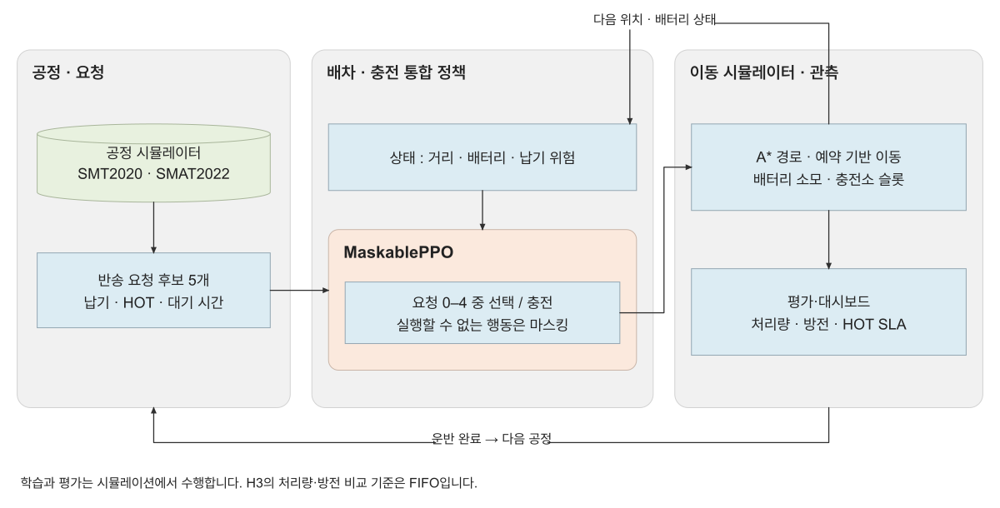
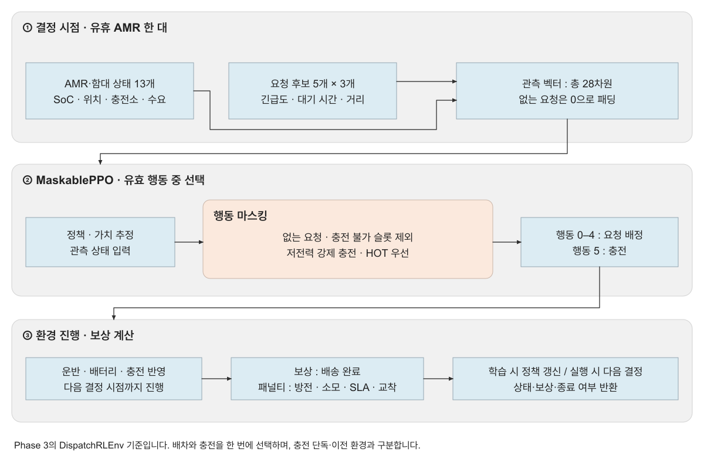
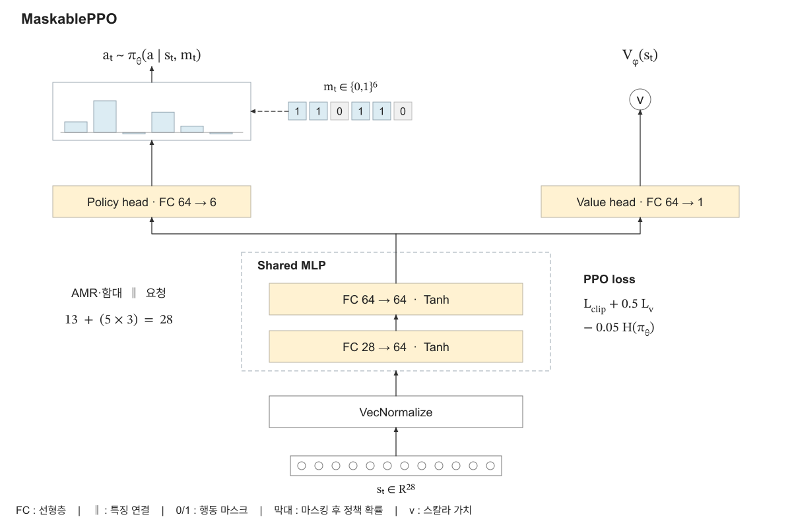
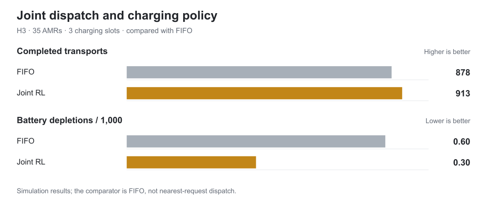

# 공장 풀가동! · AMR 운반·충전 통합 제어

[](https://www.python.org/)
[](https://pytorch.org/)
[](https://stable-baselines3.readthedocs.io/)
[](https://fastapi.tiangolo.com/)

반도체 공장의 AMR이 어떤 요청을 수행하고, 언제 충전할지 함께 결정하는 강화학습 프로젝트입니다. 공정·이동 시뮬레이터 위에 28차원 상태와 6개 행동을 갖는 MaskablePPO 정책을 구성했습니다. AMR 35대 조건에서 FIFO 대비 처리량은 약 4% 증가하고 1,000건당 방전은 0.60에서 0.30으로 감소했습니다. 결과는 특정 시뮬레이션 조건의 비교이며, 실제 공장 적용과 다른 배차 기준선에 대한 검증은 남아 있습니다.

[시뮬레이터 실행 안내](docs/how_to_run_simulator.md) · [대시보드](dashboard/README.md) · [배터리·충전 설계](docs/battery_charging_design_decisions.md)

연계 프로젝트: [Fab 가스 교체 최적화](https://github.com/912eun/26-2-rl-project-fab)에서는 이온 주입 장비의 기다리기·가스 교체 결정으로 연구 대상을 확장했습니다.

## 01. 문제

운반 로봇을 가까운 작업에 계속 배정하면 이동 거리는 줄어들지만, 배터리가 부족한 로봇도 장거리 요청을 맡을 수 있습니다. 반대로 충전을 너무 자주 보내면 운반 가능한 로봇 수가 줄어 처리량이 떨어집니다.

프로젝트는 배차와 충전을 분리했을 때의 한계를 확인하고, 두 결정을 한 정책으로 묶는 과정에 초점을 맞췄습니다. 평가는 SMT2020 공정 모델과 SMAT2022 기반 배치를 활용한 시뮬레이션에서 수행했습니다.

## 02. 시스템 구조



약 318 × 172m 배치와 1,116개 포트를 기준으로 AMR 이동을 구성했습니다. A* 경로 탐색과 예약 기반 이동 처리를 사용하며, 로봇의 배터리 소모·충전소 슬롯·운반 중 방전을 함께 반영합니다.

## 03. 실험 과정

| 단계 | 비교한 결정 | 관찰한 결과 | 다음 설계 |
|---|---|---|---|
| H1 · 배차 | 가까운 요청 우선 규칙 vs 배차 RL | 근거리 우선 규칙이 강한 기준선이었고, 배차 RL만으로 이점을 얻지 못함 | 충전 제약을 함께 고려 |
| H2 · 충전 | 임계값 충전 vs 충전 RL | 종합 점수는 개선했지만 처리량 870 → 732로 감소 | 과충전과 가용 로봇 감소 해결 |
| H3 · 통합 | 요청 배정과 충전을 동시에 선택 | FIFO 대비 처리량 증가와 방전 감소를 함께 확인 | 동일 조건의 더 강한 배차 기준선과 추가 비교 필요 |

H2는 AMR 20대·충전소 3곳·슬롯 3개 조건입니다. 종합 점수는 −164.14에서 −161.62, HOT SLA는 0.570에서 0.583으로 개선됐지만 처리량이 약 16% 감소했습니다. 충전만 최적화하면 전체 생산 성과와 어긋날 수 있음을 확인했습니다.

### 통합 정책



납기·긴급도·대기 시간을 반영해 요청 후보 5개를 만들고, 후보 요청 5개 + 충전 1개를 MaskablePPO의 행동으로 구성했습니다. 선택할 수 없는 요청과 충전 조건은 마스킹합니다. 정책은 요청까지의 거리, 배터리 잔량, 납기 위험을 함께 봅니다. 최종 H3의 `DispatchRLEnv`는 AMR·함대 상태 13개와 요청별 특징 15개를 합친 28차원 관측을 사용합니다. [세부 설계](experiments/dispatch_rl/PHASE3_DESIGN.md)

### 상태 S · 행동 A · 보상 R

| 구성 | 정의 |
|---|---|
| 결정 주체·시점 | 유휴 상태가 된 AMR 한 대, 다음 사건까지 환경을 진행한 뒤 다시 결정 |
| 상태 S (28차원) | AMR·함대 상태 13개 + 후보 요청 5개 × 특징 3개 |
| AMR·함대 13개 | SoC, 정규화 위치 x·y, 충전소 거리·여유, 대기·HOT 요청 수, 함대 SoC 평균·최저·저전력 비율, 충전·유휴 비율, 진행률 |
| 요청별 3개 | HOT 여부, 정규화 대기 시간, AMR에서 픽업 위치까지 거리. 부족한 후보는 0으로 채움 |
| 행동 A (Discrete(6)) | `0…4`: 후보 요청 선택, `5`: 충전소 이동 |
| 행동 제약 | 없는 요청 제외, 충전소 만석·SoC ≥ 0.99일 때 충전 제외, 저전력·충전 가능 시 강제 충전, HOT 요청 우선 마스킹 |
| 보상 R (성과 변화량) | 배송 완료 보상 − 방전·에너지 소모·HOT SLA 위반·교착 페널티 + 보조 보상 |

$$
r_t = 50\Delta C_t - 50\Delta D_t - 0.05\Delta E_t
      - 0.5\Delta H_t - 1.0\Delta K_t + r_t^{\mathrm{shape}}
$$

`C`는 배송 완료, `D`는 방전, `E`는 배터리 소모량, `H`는 HOT SLA를 위반한 완료 건수, `K`는 교착 발생 수입니다. `Δ`는 직전 결정 이후의 증가량입니다. 보조 보상에는 요청 배정 `+0.05`, HOT 배정 `+1.5`, 근거리 선택 최대 `+0.02` 및 충전 맥락 보상이 포함됩니다. 학습용 보상과 보고용 `transport_score`는 별도 지표입니다.

### 네트워크 계층



### 하이퍼파라미터

| 항목 | H3 학습 설정 |
|---|---|
| 정책 | MaskablePPO · `MlpPolicy`, `net_arch=[64, 64]`, Tanh |
| 정규화 | `VecNormalize`: 관측·보상 정규화, 보상 clip 10 |
| 학습률 | `3e-4` |
| Rollout / mini-batch / epochs | 환경당 2,048 step / 256 / 10 |
| 할인 γ / GAE λ / clip | 0.99 / 0.95 / 0.2 |
| Entropy / value loss / gradient clip | 0.05 / 0.5 / 0.5 |
| 환경 | AMR 35대, `top_k=5`, 충전 슬롯 3, `battery_scale=8`, lanes routing, 공정 연동 |
| 학습 예산 | 보고된 실행: 총 12시간·659,456 step, CPU 7개 환경 병렬 |
| 평가 | 시험 시드 100·101·102·103, 4개 에피소드 |

시간으로 학습을 종료하므로 같은 시간 예산이라도 장비에 따라 step 수가 달라집니다. [학습 코드](experiments/train_dispatch_rl.py), [실험 기록](experiments/dispatch_rl/PHASE3_RESULT.md)

## 04. 결과



*H3 실험: AMR 35대, 충전소 슬롯 3개 조건. 비교 대상은 FIFO이며, 근거리 우선 정책 대비 개선율을 뜻하지 않습니다.*

| 지표 | FIFO | 통합 RL |
|---|---:|---:|
| 완료 처리량 | 878 | 913 |
| 1,000건당 방전 | 0.60 | 0.30 |
| 가동률 | 해당 비교값 미기록 | 86.3% |
| HOT SLA | 0.803 | 0.812 |

배터리가 적은 로봇에 가까운 작업이나 충전을 배정하면서 방전을 줄였습니다. 다만 특정 로봇 수·충전 인프라에서 얻은 결과이므로 다른 공장 배치나 수요에서도 같은 개선을 보장하지 않습니다. 실제 공장의 생산성 개선 실적이 아닌 시뮬레이션 비교 결과입니다.

## 05. 대시보드와 운용 지원

대시보드는 실시간 실행과 저장된 리플레이를 같은 화면 구조로 보여줍니다. AMR 위치·상태, 운반 요청, 충전 상황과 KPI를 WebSocket으로 전달합니다.

LLM 보고서는 고정 규칙으로 계산한 KPI를 바탕으로 운용 상황을 설명합니다. 현재 연동은 Gemini/Vertex이며, 인증이 없을 때는 규칙 기반 보고로 대체합니다. 화면에서 선택한 조치는 기록되며, 시뮬레이터 제어에 자동 반영되는 구조는 아닙니다. 세부 동작은 [대시보드 문서](dashboard/README.md)를 참조하세요.

## 06. 실행

```bash
git clone --recurse-submodules --branch main https://github.com/912eun/insicon-ai-mcs.git
cd insicon-ai-mcs

# 최초 환경 구성: conda 필요 (Windows는 setup.bat)
bash setup.sh
conda activate ai-mcs

# setup.sh에 빠져 있는 MaskablePPO 확장 패키지
pip install sb3-contrib==1.3.0
```

`setup.sh`는 기존 `ai-mcs` 환경이 있으면 삭제 후 다시 만듭니다. 이미 환경을 사용 중이라면 스크립트를 먼저 확인하세요. 구버전 Gym과 시뮬레이터의 의존성을 맞추는 설정이 포함되어 있습니다.

H3의 환경·네트워크 구성으로 학습하는 명령입니다. `--days`는 실제 학습 시간 예산, `--sim-days`는 공정 시뮬레이션 기간입니다.

```bash
# 짧은 실행 확인
python experiments/train_dispatch_rl.py --smoke --n-amrs 35 \
  --n-envs 1 --coupled --routing lanes --charger-slots 3

# 12시간 예산, 7개 환경 병렬
python experiments/train_dispatch_rl.py \
  --n-amrs 35 --n-envs 7 --seed 0 \
  --days 0.5 --sim-days 7 --max-steps 5000 \
  --battery-scale 8 --top-k 5 --ent-coef 0.05 \
  --coupled --routing lanes --charger-slots 3 \
  --w-sla 0.5 --w-dl 1.0
```

학습 종료 후 시험 시드 100~103에서 자동 평가합니다. `experiments/dispatch_rl/`에 정책 `.zip`과 정규화 통계 `_vecnorm.pkl`을 함께 저장하고, `checkpoints/`에 중간 결과를 기록합니다. 추론·평가에서도 해당 모델과 짝이 맞는 정규화 통계를 사용해야 합니다.

대시보드의 추가 의존성을 [설치 안내](dashboard/README.md)에 따라 준비한 뒤 실행합니다.

```bash
python -m uvicorn dashboard.server:app --port 8000
```

브라우저에서 `http://localhost:8000`을 엽니다. 저장된 리플레이를 사용하거나, 아래 명령으로 새 기록을 만들 수 있습니다.

```bash
python -m dashboard.recorder --name demo --n-amrs 40 --max-steps 1200
```

학습·평가의 로봇 수, 시드, 충전 조건은 결과 비교에 영향을 줍니다. 각 실험 스크립트와 설계 문서의 조건을 함께 확인하세요.

## 07. 코드와 문서

| 경로 | 내용 |
|---|---|
| `simulator/amr/simulator.py`, `pathfinding.py` | 이동·배터리·경로 예약 |
| `simulator/fab_process/smat2022/` | 공정과 반송 환경 연결 |
| `simulator/amr/charging_env.py` | 충전 단독 결정 환경 |
| `simulator/amr/dispatch_rl_env.py` | 최종 H3 배차·충전 통합 환경 |
| `experiments/train_dispatch_rl.py` | 최종 H3 통합 정책 학습 |
| `experiments/eval_charging.py`, `eval_charging_coupled.py` | 정책 평가 |
| `dashboard/`, `llm/` | 리플레이·운용 화면·설명 보고 |

[Git 작업 규칙](docs/git.md)
